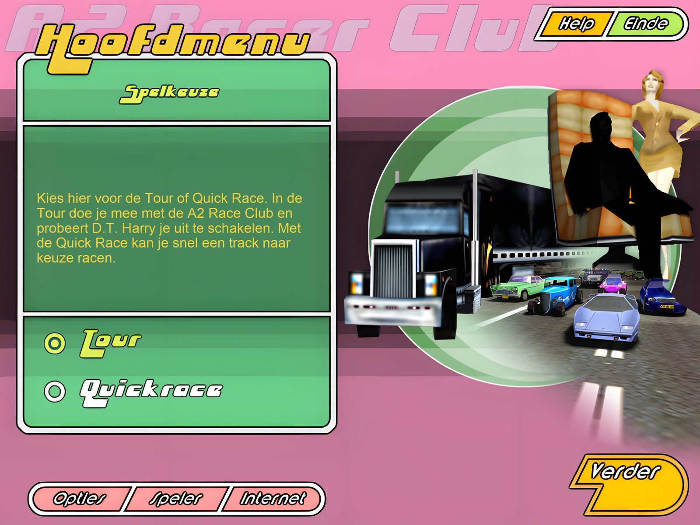
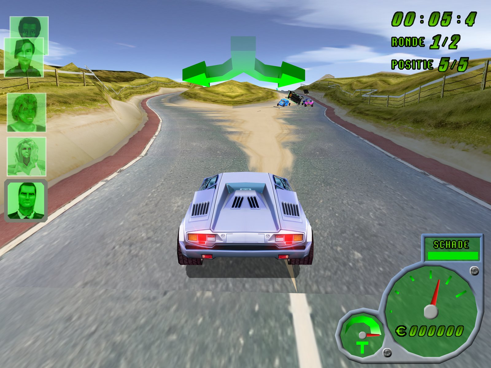
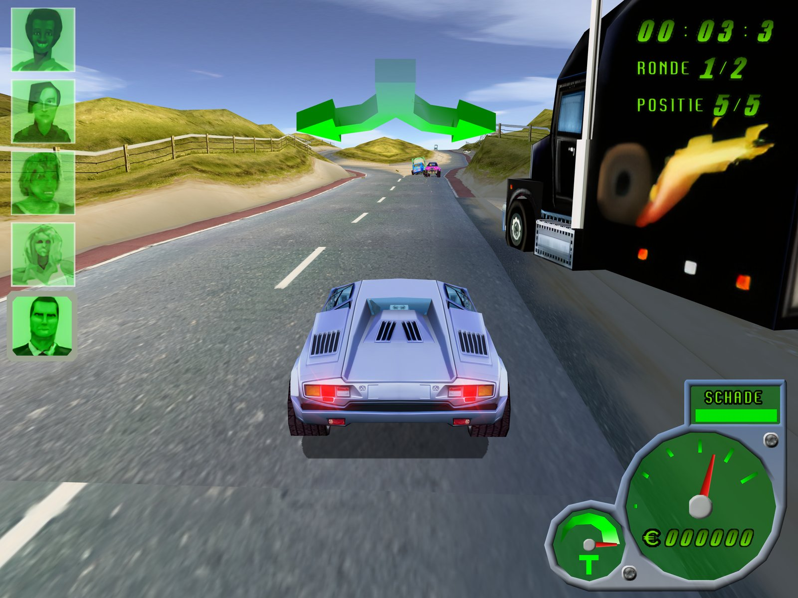
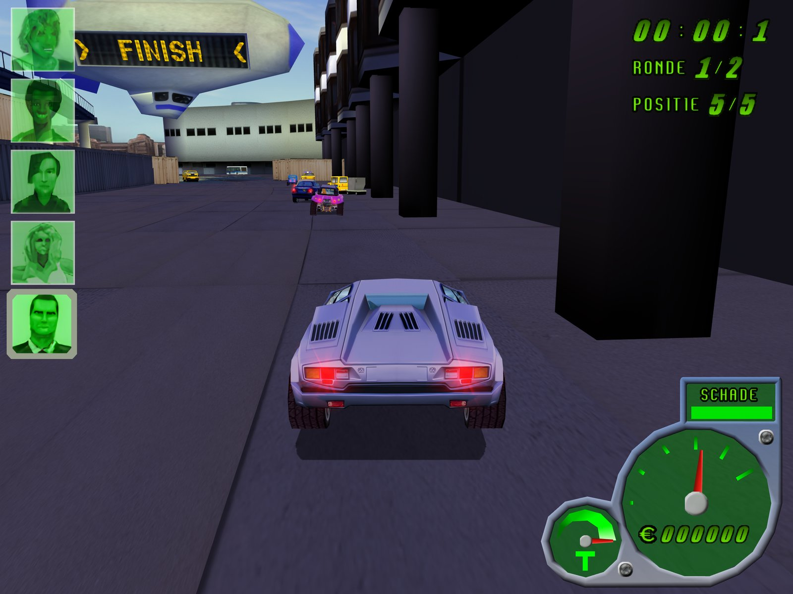
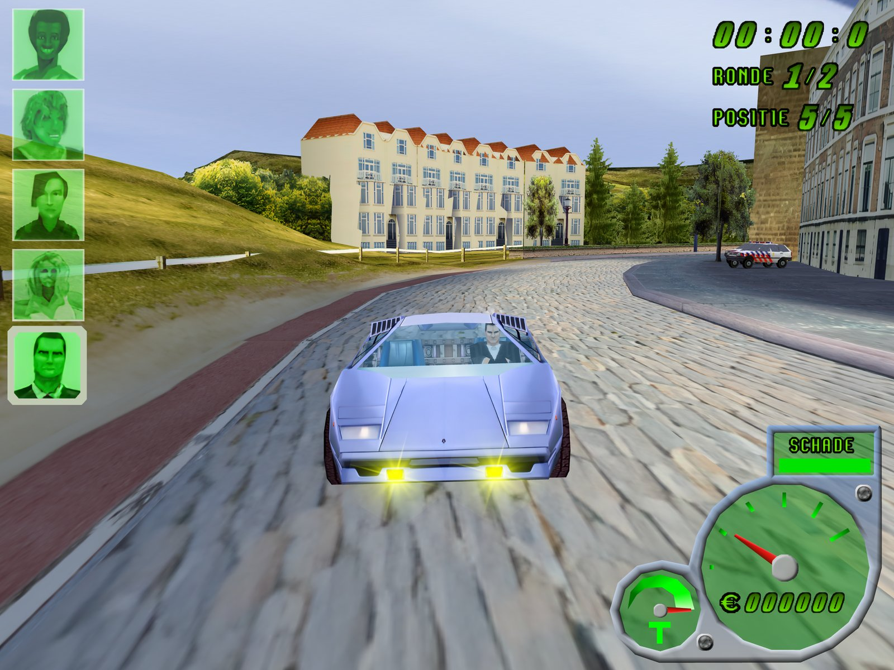
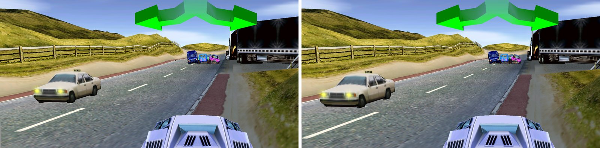
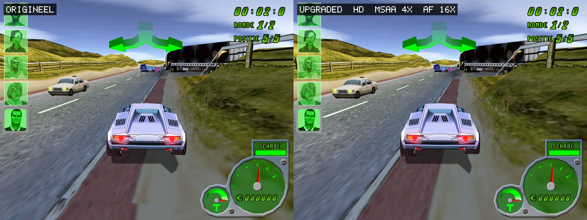
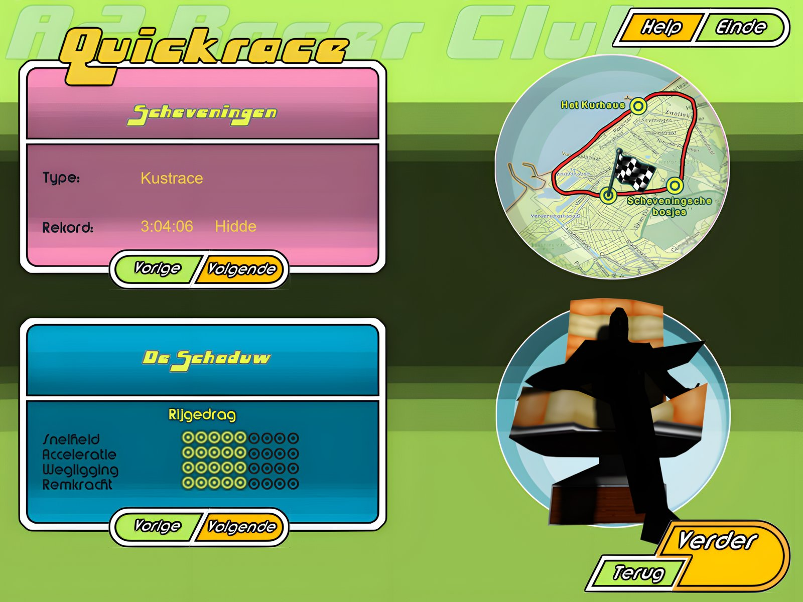
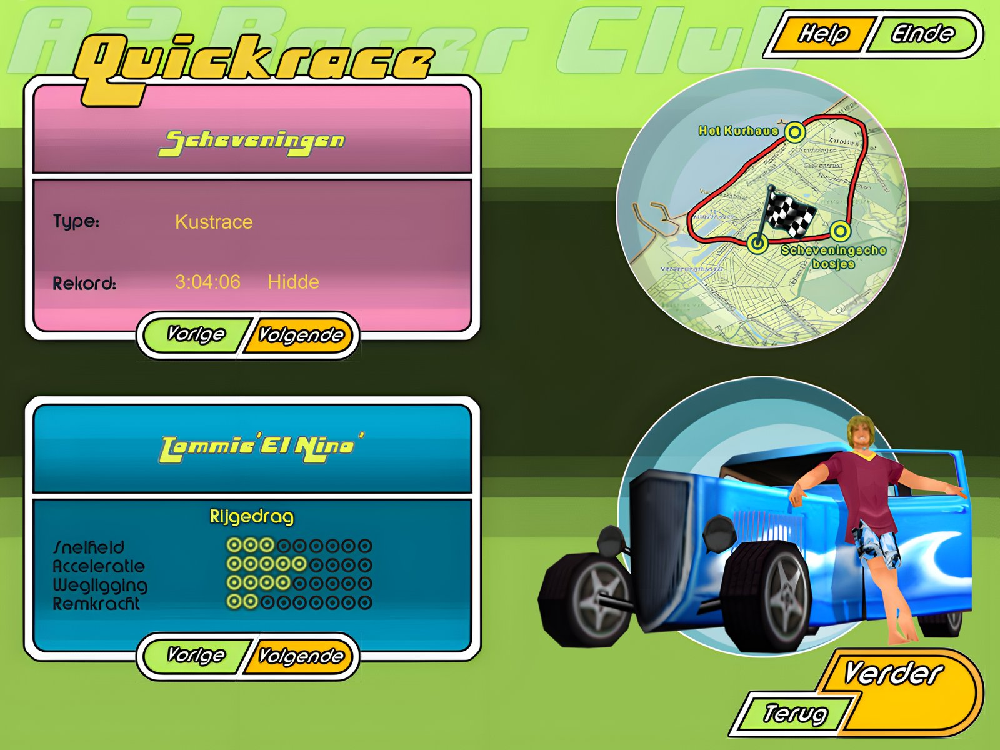

# 🏖️ A2 Racer IV Revived 🚘

**Davilex' A2 Racer IV - De politie slaat terug! (2000), herboren als echte Mac-app voor Apple Silicon. In HD, met een menu in 4K en de truck en bonustrack die Davilex ooit als download uitbracht.**

    

> [!IMPORTANT]
> **Je hebt de CD van A2 Racer IV nodig.** De game zelf zit niet in deze repo, alleen de port. Download `A2RACER4.bin` via [Nationaal Archief Educatieve Games](https://nationaalarchiefeducatievegames.nl/archief/a2-racer-iv-de-politie-slaat-terug/) ([direct op Archive.org](https://archive.org/download/a2rcriv/A2RACER4.bin), 469 MB) en geef hem aan `setup.sh`. Een ISO van v1.00 of v1.01 werkt ook.



*English below.*

## ✨ Wat is er nieuw

| | |
|---|---|
| 🍎 **Native op de Mac** | Geen Wine, geen emulator. De spelcode van de CD wordt omgezet naar een echte Apple Silicon-app |
| 🎨 **HD-textures** | Elke texture 4x opgeschaald met AI (Real-ESRGAN). Druk **F9** om live te wisselen met het origineel |
| 🖥️ **Menu in 4K** | Het hele menu scherp op elk Retina-scherm, ook F9 wisselt daar |
| 🚚 **De extra's van Davilex** | De truck van De Schaduw en de bonustrack over het Engelse platteland, die Davilex in december 2000 als download uitbracht. `setup.sh` haalt ze uit het webarchief |
| 🔍 **Scherp beeld** | Rendert op de maat van je scherm, met anti-aliasing en 16x filtering |
| 🎮 **60 fps** | Strak, ook in 4K |

## 📸 Screenshots

**Scheveningen, in HD:** met James Brons in zijn zilveren sportwagen.





**Frankfurt Airport:**



**Achteruit kijken (toets 3):**



**Origineel vs. HD**, met F9 wissel je live:





**Quick Race met De Schaduw**, de extra auto van Davilex:



**Het menu in 4K:**



## 💿 Over deze repo

In deze repo zitten **geen spelbestanden**. `setup.sh` maakt alles uit de CD (zie boven). Het HD-pack staat bij de [release hd-v1](https://github.com/DvT093/A2RacerIV-Revived/releases/tag/hd-v1); `setup.sh` downloadt het vanzelf.

## 🧰 Wat je nodig hebt
- Een Mac met Apple Silicon (M1 of nieuwer)
- `A2RACER4.bin` (zie boven)
- [Homebrew](https://brew.sh); setup.sh zegt precies wat je nog moet installeren

## 🚀 Installeren

```sh
git clone --recursive https://github.com/DvT093/A2RacerIV-Revived.git
cd A2RacerIV-Revived && ./setup.sh ~/Downloads/A2RACER4.bin
```

Of zeg in [Claude Code](https://claude.com/claude-code) in deze map: "hier is de CD, zet het op".

setup.sh haalt de spelbestanden van de CD, zet de spelcode om, bouwt de app, haalt het HD-pack (1,2 GB) en de extra's van Davilex op. De eerste keer duurt het 15-30 minuten. Daarna dubbelklik je op **A2 Racer IV.app**. De CD-image heb je dan niet meer nodig.

## 🔄 Updaten

Is er een nieuwe versie? Draai in dezelfde map:

```sh
git pull && ./setup.sh
```

Of zeg in Claude Code: "update het spel". setup.sh haalt ook de nieuwe SwARc en Davilex-RED op en bouwt alleen wat veranderd is, meestal in een paar minuten. De CD-image en het HD-pack heb je niet opnieuw nodig. Alleen als een update de omgezette spelcode raakt, duurt het weer 15-30 minuten.

## Toetsen in de race

| Toets | Wat het doet |
|---|---|
| Pijltjes | Sturen, gas, remmen |
| Cmd | Turbo (Ctrl houdt macOS zelf voor Spaces) |
| Alt (Option) | Handrem |
| Spatie | Claxon: het verkeer voor je gaat opzij |
| Return | Auto terugzetten op de weg |
| P | Pauze |
| 1 / 2 / 4 | Bumpercamera / vaste camera / andere bumpercamera |
| 3 (vasthouden) | Achteruit kijken |
| 5 | Informatie in beeld aan of uit |
| F9 | Origineel of HD (in de race en in het menu) |
| F10 / F11 | Alleen anti-aliasing / alleen filtering |

## ⚠️ Bekende problemen
- **Hunny, de pratende helper in het menu,** was een Microsoft Agent-figuurtje. Dat bestaat niet op de Mac: je ziet nu een plaatje met haar hulpvragen, zonder de antwoorden.
- **Instellen** (toetsen, stuur) en **Geavanceerd** (videokaart) in Opties doen nog niets. De toetsen staan zoals in de handleiding.
- **De truck neemt de plek van de DeLorean in**, net als in 2000 met de echte download.
- **Internet** in het menu toont alleen de vraag: de Davilex-site bestaat niet meer.

## Credits en licentie
- Gebouwd op [SwARc](https://github.com/JTM-rootstorm/x86recomp) van JT (MIT), een static recompiler voor x86-games.
- Het menu draait op de gedeelde engine van [Davilex-RED](https://github.com/DvT093/Davilex-RED), samen met [Vakantie Racer Revived](https://github.com/DvT093/VakantieRacer-Revived).
- De code in deze repo is MIT (zie `LICENSE`).
- A2 Racer IV is van Davilex en blijft van de rechthebbende. Deze repo bevat geen spelbestanden; het HD-pack is gemaakt uit de originele textures en is alleen bedoeld voor wie de game zelf heeft. Dit project heeft niets met Davilex te maken.

---

# 🏖️ A2 Racer IV Revived 🚘 (English)

Davilex' A2 Racer IV - The Cop's Revenge (2000, a Dutch racing game, original title "De politie slaat terug!") reborn as a native Apple Silicon Mac app: AI-upscaled HD textures (F9 toggles the original live), a 4K menu, a locked 60 fps, and the truck and bonus track Davilex released as a download in December 2000. Screenshots above.

No Wine, no emulator: the game code from the CD is recompiled into a real Mac app.

> [!IMPORTANT]
> **You need the A2 Racer IV CD.** The game itself is not in this repo, only the port. Download `A2RACER4.bin` via [Nationaal Archief Educatieve Games](https://nationaalarchiefeducatievegames.nl/archief/a2-racer-iv-de-politie-slaat-terug/) ([directly on Archive.org](https://archive.org/download/a2rcriv/A2RACER4.bin), 469 MB) and give it to `setup.sh`. An ISO of v1.00 or v1.01 works too.

This repo contains **no game files**. `setup.sh` builds everything from the CD (see above). The HD pack is attached to [release hd-v1](https://github.com/DvT093/A2RacerIV-Revived/releases/tag/hd-v1); `setup.sh` downloads it for you.

## 🧰 What you need
- A Mac with Apple Silicon (M1 or newer)
- `A2RACER4.bin` (see above)
- [Homebrew](https://brew.sh); setup.sh tells you exactly what to install

## 🚀 Install

```sh
git clone --recursive https://github.com/DvT093/A2RacerIV-Revived.git
cd A2RacerIV-Revived && ./setup.sh ~/Downloads/A2RACER4.bin
```

Or tell [Claude Code](https://claude.com/claude-code) in this folder: "here is the CD, set it up".

The first run takes 15-30 minutes. Then double-click **A2 Racer IV.app**. You no longer need the CD image.

## 🔄 Update

Is there a new version? In the same folder, run:

```sh
git pull && ./setup.sh
```

Or tell Claude Code: "update the game". setup.sh also fetches the new SwARc and Davilex-RED and only rebuilds what changed, usually in a few minutes. You do not need the CD image or the HD pack again. Only an update that touches the recompiled game code takes 15-30 minutes again.

## Keys in the race
Arrows steer and drive, **Cmd** = turbo, **Alt** = handbrake, **Space** = horn (traffic moves aside), **Return** = put the car back on the road, **P** = pause, **1/2/4** = cameras, hold **3** to look back, **5** = on-screen info on/off, **F9** = original or HD, **F10/F11** = anti-aliasing / filtering only.

## ⚠️ Known issues
- **Hunny, the talking helper in the menu,** was a Microsoft Agent character, which does not exist on the Mac. You see a picture with her help questions, without the answers.
- **Instellen** (keys, wheel) and **Geavanceerd** (video card) under Options do nothing yet. The keys are as in the manual.
- **The truck takes the DeLorean's slot**, as it did in 2000 with the real download.
- **Internet** in the menu only shows the question: the Davilex site no longer exists.

## Credits and license
Built on [SwARc](https://github.com/JTM-rootstorm/x86recomp) by JT (MIT). The menu runs on the shared engine of [Davilex-RED](https://github.com/DvT093/Davilex-RED), together with [Vakantie Racer Revived](https://github.com/DvT093/VakantieRacer-Revived). The code in this repo is MIT (see `LICENSE`). A2 Racer IV belongs to Davilex and its rights holder; this repo contains no game files, and the HD pack is derived from the original textures and meant only for people who own the game. This project is not affiliated with Davilex.
